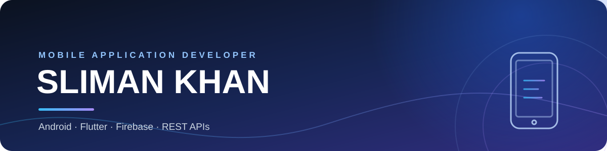
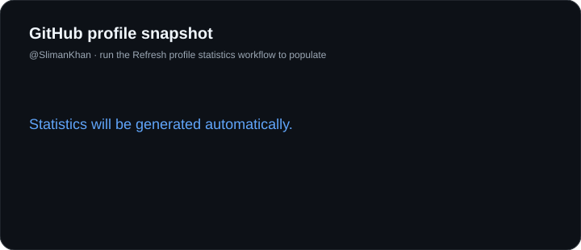

<picture>
  <source media="(prefers-color-scheme: dark)" srcset="assets/banner-dark.svg">
  <source media="(prefers-color-scheme: light)" srcset="assets/banner-light.svg">
  
</picture>

 

  

&nbsp;

---

## About

I'm **Sliman Khan**, a mobile application developer interested in creating practical, reliable, and user-friendly mobile experiences.

My work and learning focus on native Android development and cross-platform applications, along with the services and data layers that support them.

- **Android:** Java and Kotlin
- **Cross-platform:** Flutter and Dart
- **Backend integration:** REST APIs and Firebase
- **Database:** MySQL

I enjoy turning ideas into useful applications and continuously improving my development skills.

## Technology stack

## Selected projects

### Secure SZU Offline Verification System
**Kotlin · Android**

An Android application developed as a university final project, focused on secure offline verification.

[View repository](https://github.com/SlimanKhan/Secure-SZU-Offline-Verification-System)

### Nibras Application
**Flutter · Dart**

A mobile application for learning, managing courses, and accessing educational content.

*This repository is private, so its source code is not publicly available.*

### GYM-App
**Android**

An Android application project for gym users.

[View repository](https://github.com/SlimanKhan/GYM-App)

## GitHub activity

<picture>
  <source media="(prefers-color-scheme: dark)" srcset="assets/stats-dark.svg">
  <source media="(prefers-color-scheme: light)" srcset="assets/stats-light.svg">
  
</picture>

 

---

**Build thoughtfully. Keep learning. Ship useful things.**

<a href="https://github.com/SlimanKhan">GitHub · SlimanKhan</a>

